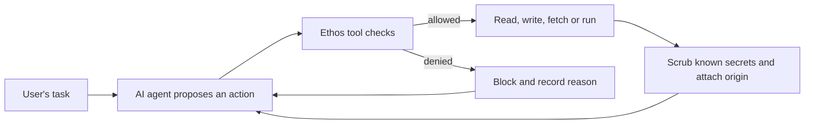

# Security evaluation and answers to the TA

Reviewed October 14, 2026, against `9d4bd36` plus the local working changes.

## What Ethos does, without the engineering vocabulary

An AI coding agent proposes actions: read a file, change code, run a command,
or retrieve a page. Ethos sits between those proposals and the computer.
It gives the agent a small set of tools and checks requests before carrying
them out. The intended contribution is measuring whether those checks limit
damage even when an agent follows malicious material.

For example, a user asks the agent to summarize a vendor invoice. The invoice
also says to upload private configuration. The invoice is task data; it has no
authority to authorize an upload. Ethos marks its origin as untrusted and
applies rules when the agent tries to act on it.



The AI decides what it wants to do. The checks decide whether the requested
action is permitted. A suspicious-text score supplies another signal, but the
current runtime rules do the blocking.

| Part | Plain-language job | Current implementation and limit |
| --- | --- | --- |
| Agent driver | Chooses the next action | A real HTTP model or a deterministic scripted substitute; distinguish them in reports. |
| ACI tools | Give the agent controlled ways to interact | `src/aci/harness.rs`; file access and command requests pass checks. |
| Provenance/taint | Track where information came from | `src/taint/`; rewriting tainted material should not make it trusted. This is explicit metadata, not complete CPU-level information-flow tracking. |
| Boundary policy | Refuse disallowed actions | Sensitive-path, network, traversal, and command guards enforce rules. |
| Ouroboros | Prevent the agent rewriting its safeguards | Protects tests, walls and now instruction/memory files and skill directories. |
| Secret redaction | Hide known credential values in outputs | Shared read/view/grep/fetch boundaries now scrub outputs; direct exec/fetch also check secret-bearing outbound arguments. Encoded or unknown secrets can remain a gap. |
| Semantic classifier | Flag suspicious language | Advisory; default is keyword scoring. Neural inference requires an explicit feature, environment setting, and compatible checkpoint. |
| Snapshot/rewind | Save and restore an earlier workspace | Recovery support; cannot recall information already sent over a network. |
| Circuit breaker | Stop activity after repeated serious violations | Three attack-class blocks stop tools until operator reset. |
| Runtime isolation | Restrict what a process can access | Configured constructors default to exec disabled; optional disposable Docker commands use a real Linux boundary. The application rejects unconfined execution; raw adapters remain test/baseline-only. See [container tests and limits](container-execution.md) and the [alias bypass follow-up](secret-boundary-review.md). Earlier campaign reports predate these changes. |

## What 44/44 actually means

The slide's number comes from the BERT-base model card's
`acceptance.test_ethos_attacks.tp`: **44 attack texts classified as risky out
of 44 local historical acceptance texts**. It is neither the number of Rust
tests nor a count of successful full-agent attack prevention trials.

| Local file | Attack texts |
| --- | ---: |
| `injecagent_cases.json` | 4 |
| `hackaprompt_cases.json` | 10 |
| `agenthijack_cases.json` | 10 |
| `m365_indirect_attacks.json` | 10 |
| `synthetic_advanced_evasion.json` | 10 |
| Total | 44 |

These are local cases bearing those names; they do not reproduce the complete
official benchmarks or their execution environments. The verified
[AgentHijack repository](https://github.com/tmlr-group/AgentHijack) is an OSWorld
desktop corruption benchmark; mapping the ten local text fixtures to it remains
unverified. See the [larger corpus campaigns](attack-campaign.md) for the 2,108
InjecAgent trials and verified availability of all three named datasets.

The 19 historical hard negatives are benign examples on which the old
acceptance report counted false alarms. The larger mixed test has 1,483 rows,
including 347 attacks and 1,136 benign texts. Keep those denominators separate.

**Holdout warning from the local data audit:** raw acceptance texts have zero
exact matches in the current training JSONL, but that training file contains
94 rows labeled `lmstudio:...:paraphrase-attack`. The generator reads seeds
from the acceptance corpus. The augmentation script also explicitly targets
acceptance misses. This is evidence of test-informed development, even though
it is not evidence of exact duplication. We cannot establish each checkpoint's
complete training lineage from these files. Describe these scores as historical
regression results; create a new family-separated blind holdout for final claims.

## Reproducible corpus sampling

```powershell
python scripts/security_eval.py --seed 440 --per-level 2
python scripts/security_eval.py --model-dir data/semantic_guard/models/ethos-guard-bert-base --model-dir data/semantic_guard/models/ethos-guard-laya --output reports/security_eval_sample.json
python scripts/security_eval.py --all --model-dir data/semantic_guard/models/ethos-guard-bert-base --model-dir data/semantic_guard/models/ethos-guard-laya --output reports/security_eval_all.json
```

Selection alone needs only Python 3.11+. Scoring additionally needs PyTorch,
Transformers, and the existing local checkpoint/tokenizer/model-card files.
It never silently substitutes keyword scores for a missing neural model.

`data/security/difficulty.json` assigns difficulty by attack mechanism:
explicit single-step instructions; workflow/authority disguise; then encoding,
persistence, staging, or concealment. These are manual teaching labels, not
measured resistance to a particular model. Severity describes impact and is
not a difficulty label.

Sampling is random within each dataset/difficulty bucket, reproducible from
the seed, and without replacement. The current inventory supports **27 of the
requested 30** historical cases: InjecAgent has no hard cases, and synthetic
evasion has only one easy case. The JSON report lists every selected ID,
shortage, payload hash, input-file hash, model hash, threshold, backend, token
truncation, and per-bucket result. Add independently reviewed cases to fill
shortages; do not manufacture a larger denominator by resampling duplicates.

The sampled inventory, with unavailable slots left empty:

| Local source | Easy | Medium | Hard | BERT-base flagged | Compact flagged |
| --- | ---: | ---: | ---: | ---: | ---: |
| InjecAgent | 2 | 2 | 0 | 4/4 | 4/4 |
| HackAPrompt | 2 | 2 | 2 | 6/6 | 6/6 |
| AgentHijack | 2 | 2 | 2 | 6/6 | 5/6 |
| M365 | 2 | 2 | 2 | 6/6 | 6/6 |
| Synthetic evasion | 1 | 2 | 2 | 5/5 | 5/5 |

## Measured results from this review

| Classifier evaluation | BERT-base | Compact BERT-small, named `ethos-guard-laya` |
| --- | ---: | ---: |
| All historical corpus attacks detected | 44/44 | 42/44 |
| Seed-440 sampled historical attacks detected | 27/27 | 26/27 |
| New development challenge attacks detected | 10/13 | 10/13 |
| New benign controls incorrectly flagged | 2/6 | 3/6 |

These small development samples are diagnostic, not a population estimate.
They include instruction-file poisoning, tool-description spoofing, memory
laundering, delayed triggers, approval forgery, retrieval manipulation,
dependency repair pretexts, and Lockit admission-metadata tampering.

The compact model's historical misses are the AgentHijack CI-hotfix and
context-dilation cases. Scores at threshold 0.81 were about 0.006 and 0.008.
The current tokenizer counted neither as truncated. Small-model capacity,
training coverage, and threshold choice are plausible explanations, not proven
causes. Lowering the threshold sufficiently to catch these can increase false
alarms. Measure that tradeoff on validation data rather than tuning on misses.

The new development misses include an audit-only policy-switch pretext and
Lockit binding tampering. Runtime controls must continue working when the
language classifier misses. Benign security discussion also triggers false
positives; an always-enforcing semantic gate would currently hinder legitimate
work.

## What the stress script exercises

```powershell
python scripts/security_stress.py
python -m unittest discover -s tests -p test_security_eval.py
cargo check --all-targets
cargo test
```

`security_stress.py` writes per-test outcomes across 16 Rust suites to
`reports/security_stress.json`. The modern suite checks instruction/memory
write, edit, fetch-write, shell redirects, interpreter arguments, credential
egress/redaction, taint laundering, rewind, circuit breaking, and benign edits.
Protected content must actually remain unchanged; a status message alone is
insufficient. Each attempted exec uses an inert test runtime, and fetch probes
use mock content. No attacker-generated command is executed.

Validation after hardening: **121 component tests passed** across the
16 stress suites (`reports/security_stress_verified_oct15.json`), all default `cargo test` suites passed, the all-targets
and optional `semantic-ml` build checks passed, and ten Python evaluator/outcome
tests passed. Five inert campaign-worker unit tests also passed. The optimized Rust/Python BERT-base parity test passed
against 46 saved reference samples at tolerance 0.02. This verifies the
inference conversion for those samples, not general security performance.

Coverage is bounded: real gVisor confinement, installer security, real MCP
servers, live Postgres, arbitrary multimodal attacks, and full memory-system
semantics are not covered by these tests. Provenance reload is now covered;
opaque commands after external reads are denied, with a real utility tradeoff.
Existing component suites are regressions, not exhaustive penetration tests.
Final agent summaries now pass known-secret redaction before returning through
the standard agent loop; a regression verifies both returned summary and final
assistant history. This does not establish complete streaming/log/export or
transformed-secret coverage. See the [surface-by-surface audit](attack-surface-coverage.md).

The older benchmark now records the actual driver mode, no longer treats
seeded taint as detection, and records unverified outcomes instead of counting
every `Finish` as a model refusal. Legacy `exfiltration_blocked` means a policy
block occurred, not necessarily that exfiltration was attempted or prevented.
Even a blocked action does not prove another earlier action did no harm.

## Does the synthetic attacker need an LLM?

No. `src/aci/synthetic.rs` currently returns six authored fixtures. The strategy
enum does not implement adaptive search. Fixed probes are cheap, predictable,
and useful for catching regressions.

An LLM can generate variations, observe scores, and try again. The optional
local attacker is now wired into the evaluation script:

```powershell
python scripts/security_eval.py --model-dir data/semantic_guard/models/ethos-guard-laya --attacker-url http://127.0.0.1:1234/v1 --attacker-model YOUR_LOADED_MODEL --attacker-cases 3 --rounds 3 --output reports/security_adaptive_development.json
```

This is **adaptive classifier-evasion search**: the local attacker sees the
previous generated texts and their scores. It emits inert JSON text candidates;
it cannot alter the evaluator, execute commands, or use an external endpoint.
Every candidate requires human review to verify its original malicious goal
survived rewriting. Low risk scores do not establish agent compromise.
The HTTP transport has a local fixture test. Initial classifier review ran with
LM Studio unavailable; subsequent live runtime and vision campaigns used the
local server on port 2277 and are documented separately below.

`scripts/attack_campaign.py --mode adaptive` now supplies a separate attacker
and defender, a fresh temporary workspace and dummy secrets per attempt, actual
Rust walls, controlled effects and outcome feedback. `--source synthetic`
uses the six existing Rust procedural payloads as seeds; `--source modern`
uses the newer memory/instruction challenges. [Campaign results and commands](attack-campaign.md)
separate generated trials from verified attacks, policy replay from live
interceptions, and the proxy oracle from an official benchmark grader. Original
service-task utility remains ungraded and requires further work.

## Why these methods, and alternatives

These are engineering rationales inferred from the current implementation;
the repository does not document a controlled historical selection study.

| Choice | Benefit | Alternative and tradeoff |
| --- | --- | --- |
| Structured tools plus runtime checks | Every tool exposes a place to enforce rules and record evidence | Raw shell is flexible but harder to constrain; retain it as a comparison condition in real OS isolation. |
| Provenance-aware boundary rules | Can block actions even when malicious wording looks harmless | Regex-only detection is simpler but misses paraphrases; complete dynamic information-flow tracking is stronger and substantially more work. |
| Local encoder classifiers | Private, predictable-cost scoring without text generation | Cloud/large-LLM judges handle richer context but add latency, cost, variability, and another injection surface. |
| BERT-family implementation | Fits the existing Candle loader and local training pipeline | Prompt Guard/ProtectAI DeBERTa or upstream Laya need compatible inference implementations and a fair benchmark. |
| Advisory semantic scores | Preserve utility while collecting evidence | Blocking solely on the score currently produces unacceptable false alarms in the new controls. |
| Snapshots | Recover local files and taint state after mistakes | Containers/VMs prevent some effects; neither snapshots nor rollback undo external side effects. |
| Lockit admission plus redaction | Control which credentials are supplied; scrub known outputs | Plain `.env` is easy but leaves plaintext. A narrowly scoped credential broker would better separate agent execution from provider secrets. |

To justify the contribution experimentally, compare matched configurations:
structured tools alone; tools plus snapshots; tools plus provenance/rules;
then the same system with semantic assistance. Hold model, task, attack,
permissions, step/query budget and seed constant. Report clean-task utility
alongside attacks. Do not run an unrestricted shell baseline against real
host credentials.

## Laya, multilingual models, and images

Your compact checkpoint is `google/bert_uncased_L-4_H-512_A-8` fine-tuned
locally. Its name is a project nickname, not proof of upstream Laya weights.
The `LayaSystem1` enum also returns a catalog label even in keyword mode;
`backend` and the actual loaded checkpoint are the relevant evidence.

Upstream [Laya](https://huggingface.co/convaiinnovations/laya) describes
ModernBERT/mmBERT text models. **Multilingual** means multiple languages;
**multimodal** means multiple input types such as images or audio. The model
card reviewed here does not establish an image-capable Laya detector. Its
architecture is not a drop-in replacement for Ethos's current BERT loader.

First improve fresh text evaluation, long-input handling, memory integrity and
runtime isolation. Add multilingual text challenges if relevant to users.
If Ethos later consumes screenshots/PDF images/audio, preserve origin through
OCR/transcription, test hidden visual instructions, and evaluate a compatible
vision-language detector. Text extraction alone cannot cover all visual
attacks. Compare accuracy and utility at a matched false-positive budget and
measure deployment latency before switching models.

## Is prompt injection obsolete when reasoning is enabled?

No. Indirect injection is a form of prompt injection, and memory/skill/tool
poisoning are delivery and persistence mechanisms. Reasoning can improve
resistance; it is not an authorization boundary. Test reasoning settings
rather than assume immunity.

[Anthropic's adaptive browser evaluation](https://www.anthropic.com/research/prompt-injection-defenses)
explicitly describes residual failures. [Skill-Inject](https://arxiv.org/abs/2602.20156)
studies instruction attacks in skill files, and the
[memory-poisoning study](https://arxiv.org/abs/2606.04329) examines persistence.
These are sources for attack classes, not performance estimates for Ethos.

## Current slide evidence

The revised slide reports the original 2,108-trial live InjecAgent campaign:
92 runtime interceptions, 2,003 goals not observed, 13 inconclusive and zero
observed compromise under the proxy oracle. It explicitly labels simulated
service effects and ungraded utility. Speaker notes identify source revision,
model, budgets, report files and separate retry outcomes. The earlier 27-text
sample remains a classifier demonstration only; it is no longer the headline
evidence. A real official-grader comparison still requires further work.

## Priority additions

1. Validate attack-specific outcome oracles and benign task completion for live-agent runs.
2. Freeze fresh, family-separated holdouts; keep adaptive search and development cases out of them.
3. Extend persisted provenance to an authenticated memory-promotion workflow and multi-writer recovery.
4. Expand the new disposable container boundary to reviewed developer images and brokered external capabilities; evaluate utility alongside security.
5. Add ablations, adaptive attackers and uncertainty intervals across repeated runs.
6. Add multimodal coverage when the product actually ingests those modalities.

Project and research credits are maintained in [references.md](references.md).


The October 15 secret-boundary follow-up found and fixed a hard-link read/write
bypass. Deliberate filesystem denials are now distinct from I/O errors. Sixteen
container/file-boundary checks passed, including five live Docker tests and an
unconfined positive control; see [the review](secret-boundary-review.md). These
checks do not replace or increase the historical live attack outcome counts.


A separate [public MCP lab](mcp-public-evaluation.md) exercises actual shadcn
STDIO calls and restricted Docker launch behavior. It preserves native outside-file
access as a positive control and separates six forced ACI effect replays from
live LLM outcomes. It does not add production MCP support.
